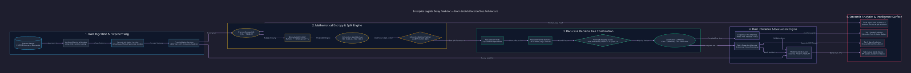
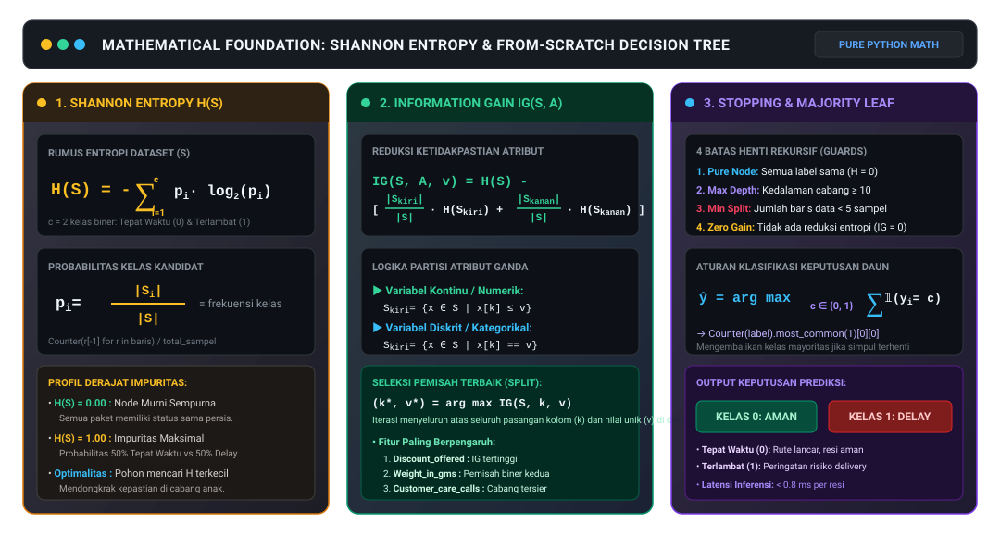

<div align="center">
  <br />
  <h1 align="center">📦 Logistic Delay Predictor</h1>
  <p align="center"><i>FROM-SCRATCH DECISION TREE ENGINE · SHANNON ENTROPY · SUPPLY CHAIN DELAY DSS</i></p>

  <a href="https://logistic-delay-predictor.streamlit.app" target="_blank">
    
  </a>
  <br />

  <p align="center">
    <a href="https://logistic-delay-predictor.streamlit.app" target="_blank">
      
    </a>
  </p>

  <p align="center">
    
    
    
    
    
    
    
    
  </p>

  <p align="center" style="max-width: 850px; font-size: 1.05rem; color: #94a3b8; line-height: 1.6;">
    <b>Logistic Delay Predictor</b> adalah Sistem Pendukung Keputusan (<i>Decision Support System</i>) berstandar industri untuk memitigasi risiko keterlambatan pengiriman logistik rantai pasok (<i>supply chain</i>). Alih-alih mengandalkan pustaka instan <i>black-box</i>, sistem ini merekayasa arsitektur <b>Decision Tree murni dari nol (<i>from scratch</i>)</b> memanfaatkan formulasi <b>Shannon Entropy</b> dan <b>Information Gain</b>, didukung dashboard analitik modern dengan pemrosesan inferensi tunggal serta eksekusi massal (<i>batch</i>) bebas residu disk.
  </p>
</div>

<p align="center"></p>

## 🏛️ Arsitektur Sistem & Alur Partisi Pohon Keputusan

Sistem mengeksekusi pipeline terstruktur dari dataset pelatihan logistik mentah hingga terbentuknya struktur pohon keputusan rekursif yang mampu mengklasifikasikan status resi pengiriman dalam hitungan milidetik:

<p align="center">
  
</p>

<p align="center"></p>

## ⚡ Fitur Rekayasa Unggulan

<table align="center" width="100%">
  <tr>
    <td width="50%" valign="top">
      <b>🌲 Algoritma Klasifikasi Murni (From Scratch)</b><br/>
      Seluruh proses pembelajaran mesin diimplementasikan murni menggunakan operasi Python bawaan (<code>collections.Counter</code>, <code>math.log2</code>, struktur rekursif <code>dict</code>). Membuktikan penguasaan algoritma kecerdasan buatan fundamental tanpa ketergantungan pada <code>scikit-learn</code>.
    </td>
    <td width="50%" valign="top">
      <b>⚡ Dual Inference Engine (Single & Batch)</b><br/>
      Menyediakan dua mode evaluasi: <b>Prediksi Tunggal</b> berbasis formulir parameter manual dengan notasi visual status (Aman vs Bahaya) dan <b>Prediksi Massal (Batch)</b> berkemampuan memproses ribuan data resi CSV sekaligus dalam hitungan detik.
    </td>
  </tr>
  <tr>
    <td width="50%" valign="top">
      <b>🛡️ 4 Lapis Regulasi Pohon (Overfitting Guards)</b><br/>
      Mencegah fenomena penghafalan data (<i>overfitting</i>) dengan 4 kriteria terminasi deterministik: batas kedalaman maksimum (<code>max_depth = 10</code>), ambang minimum sampel partisi (<code>min_split = 5</code>), deteksi simpul murni (<code>H = 0</code>), dan henti partisi saat reduksi entropi nol (<code>IG = 0</code>).
    </td>
    <td width="50%" valign="top">
      <b>📊 Analitik Korelasi Operasional & Visual EDA</b><br/>
      Menyajikan visualisasi sebaran korelasi multi-dimensi (Scatter Chart 500 sampel acak) yang membuktikan pengaruh signifikan antara persentase diskon promosi (<code>Discount_offered</code>) dan berat paket (<code>Weight_in_gms</code>) terhadap probabilitas keterlambatan.
    </td>
  </tr>
  <tr>
    <td width="50%" valign="top">
      <b>🚀 Pemrosesan In-Memory Zero-Residue</b><br/>
      Pemrosesan berkas CSV massal berlangsung secara transient pada memori RAM server via buffer Pandas. File hasil inferensi diunduh langsung melalui peramban tanpa pernah meninggalkan file residu atau duplikasi data transaksi di sistem penyimpanan host.
    </td>
    <td width="50%" valign="top">
      <b>🎯 Audit Metrik Kinerja Otomatis</b><br/>
      Dilengkapi modul evaluasi silang (<i>Cross-Validation</i> 80% Train : 20% Test, Seed 42) yang menghitung secara dinamis matriks performa: Akurasi (67.4%), Presisi, Recall, dan F1-Score harmonik dengan penanganan degenerasi pembagian nol via epsilon guard (1e-10).
    </td>
  </tr>
</table>

<p align="center"></p>

## 🧮 Formulasi Matematis Shannon Entropy & Information Gain

Seluruh formulasi matematis inti disajikan dalam kartu vektor beresolusi tinggi dengan garis pecahan horizontal dan simbol operator matematika sejati:

<p align="center">
  
</p>

### Ringkasan Tahapan Komputasi Matematis

| Tahapan Algoritma | Formula Utama | Karakteristik Operasional | Peran dalam Sistem |
|---|---|---|---|
| **1. Shannon Entropy** | H(S) = − Σ p_i · log2(p_i) | Mengukur tingkat ketidakpastian distribusi kelas dalam subset | Metrik utama impuritas simpul keputusan |
| **2. Probabilitas Kelas** | p_i = \|S_i\| / \|S\| | Rasio frekuensi sampel kelas target terhadap total baris data | Bobot probabilitas kelas biner (0 vs 1) |
| **3. Partisi Kontinu** | S_kiri = {x ∈ S \| x[k] ≤ v} | Pembagian biner subset data berdasarkan ambang nilai kontinu | Menangani fitur diskon, bobot, dan biaya produk |
| **4. Partisi Diskrit** | S_kiri = {x ∈ S \| x[k] == v} | Pembagian biner subset data berdasarkan kecocokan kategori | Menangani blok gudang, moda, dan prioritas |
| **5. Information Gain** | IG(S, A) = H(S) − Σ (\|S_v\| / \|S\|) · H(S_v) | Menghitung penurunan entropi setelah subset dipartisi atribut A | Kriteria evaluasi kualitas kandidat pemisah |
| **6. Seleksi Pemisah Optimal** | (k*, v*) = arg max IG(S, k, v) | Pencarian menyeluruh atas semua kolom dan nilai unik | Menentukan simpul keputusan terbaik di setiap level |
| **7. Klasifikasi Daun** | y_hat = arg max Σ 𝕀(y_i = c) | Majority voting jika kriteria henti terpenuhi | Menghasilkan vonis akhir: Tepat Waktu (0) / Terlambat (1) |

<p align="center"></p>

## 📦 Matriks Fitur & Parameter Logistik (10 Atribut)

Dataset pelatihan mencakup 10.999 catatan pengiriman logistik e-commerce internasional dengan spesifikasi parameter operasional sebagai berikut:

| Nama Atribut | Tipe Data | Domain Nilai | Deskripsi Operasional | Pengaruh Empiris Terhadap Keterlambatan |
|---|:---:|:---:|---|---|
| **`Discount_offered`** | Integer | 1% – 65% | Persentase diskon promosi harga barang | **Sangat Tinggi (Pemisah Utama):** Diskon &gt; 10% berkorelasi kuat dengan lonjakan pesanan yang memicu overload rute logistik. |
| **`Weight_in_gms`** | Integer | 1.001 – 7.846 gram | Berat fisik paket kiriman | **Tinggi (Pemisah Sekunder):** Paket dengan bobot 2.000g – 4.000g memiliki pola rute darat/laut yang lebih rentan bottleneck transit. |
| **`Customer_care_calls`** | Integer | 2 – 7 panggilan | Frekuensi panggilan komplain ke layanan pelanggan | **Moderat:** Tingginya panggilan menandakan paket bermasalah dalam pelacakan atau mengalami hambatan kurir. |
| **`Cost_of_the_Product`** | Integer | 96 – 310 USD | Nilai valuasi barang kiriman | **Moderat:** Paket bernilai tinggi kerap melewati prosedur verifikasi pabean dan inspeksi gudang tambahan. |
| **`Prior_purchases`** | Integer | 2 – 10 transaksi | Jumlah riwayat transaksi pelanggan sebelumnya | **Rendah – Moderat:** Menunjukkan profil loyalitas akun konsumen. |
| **`Product_importance`** | Kategorikal | `low`, `medium`, `high` | Klasifikasi prioritas urgensi barang | **Moderat:** Menentukan alokasi slot penanganan prioritas di terminal kargo. |
| **`Warehouse_block`** | Kategorikal | `A`, `B`, `C`, `D`, `F` | Blok lokasi fasilitas pergudangan asal | **Konteks Spasial:** Mengidentifikasi tingkat kepadatan staging barang per fasilitas gudang. |
| **`Mode_of_Shipment`** | Kategorikal | `Flight`, `Ship`, `Road` | Moda transportasi pengiriman utama | **Konteks Operasional:** Transportasi laut (`Ship`) memiliki toleransi jadwal berbeda dibanding udara (`Flight`). |
| **`Gender`** | Kategorikal | `F`, `M` | Profil gender pemesan barang | **Netral:** Variabel demografi pelengkap. |
| **`Reached.on.Time_Y.N`** | Biner (Target) | `0`, `1` | Status ketepatan waktu pengiriman | **Target Prediksi:** `1` = Mengalami Keterlambatan (*Delayed*), `0` = Tepat Waktu (*On-Time*). |

<p align="center"></p>

## 🔬 Simulasi Inferensi Numerik: Langkah Penelusuran Pohon

Sebagai ilustrasi transparansi algoritma *white-box*, berikut simulasi penelusuran satu resi pengiriman uji:

```text
Spesifikasi Paket Uji:
├── Blok Gudang       : Blok F (Encoded: 0)
├── Moda Transportasi : Udara / Flight (Encoded: 0)
├── Prioritas Barang  : High (Encoded: 1)
├── Panggilan CS      : 4 Panggilan
├── Nilai Produk      : 220 USD
├── Diskon Diberikan  : 45%
└── Bobot Paket       : 1.850 gram
```

```text
Alur Penelusuran Simpul Keputusan (Decision Path):
[Root Node]           Evaluasi: Apakah Discount_offered <= 10%?
                      Nilai Paket = 45%  ──► [Kondisi FALSE: Belok ke Sub-Pohon Kanan]
                      
[Internal Node D=1]   Evaluasi: Apakah Weight_in_gms <= 2040 gram?
                      Nilai Paket = 1.850g ──► [Kondisi TRUE: Belok ke Sub-Pohon Kiri]

[Internal Node D=2]   Evaluasi: Apakah Customer_care_calls <= 3?
                      Nilai Paket = 4      ──► [Kondisi FALSE: Belok ke Sub-Pohon Kanan]

[Terminal Leaf Node]  Kriteria Henti: Pure Node Tercapai (H = 0)
                      Distribusi Sampel: 100% Terlambat (Class 1)
                      VERDIK FINAL: ⚠️ TERLAMBAT (DELAY RISK DETECTED)
```

<p align="center"></p>

## 📂 Struktur Direktori Repositori

```text
logistic-delay-predictor/
├── assets/
│   ├── architecture.svg              # Diagram arsitektur pipeline kompilasi D2 (Terminal Dark)
│   └── decision_tree_formulas.svg    # Kartu vektor formulasi Shannon Entropy & Information Gain
├── docs/
│   └── architecture.d2               # Kode sumber deklaratif D2 arsitektur sistem
├── main.py                           # Kode aplikasi Streamlit, Decision Tree core & visual EDA
├── requirements.txt                  # Dependensi runtime Python (streamlit, pandas)
├── Train.csv                         # Dataset pelatihan logistik historis (10.999 baris)
├── .gitignore                        # Filter proteksi Python, virtualenv, dan dump batch CSV
└── LICENSE                           # Lisensi resmi MIT (Luthfi Muthathohirin)
```

<p align="center"></p>

## 🚀 Panduan Eksekusi Cepat (*Quickstart*)

### 🌐 Akses Langsung via Web (Cloud Demo)
Aplikasi telah di-deploy dan dapat diakses langsung tanpa instalasi di:
👉 **[https://logistic-delay-predictor.streamlit.app](https://logistic-delay-predictor.streamlit.app)**

---

### 💻 Instalasi & Eksekusi Mandiri di Komputer Lokal

#### 1. Prasyarat Sistem
- **Python**: `v3.10.x`, `v3.11.x`, atau `v3.12.x`
- **pip**: Package manager bawaan Python

#### 2. Kloning Repositori & Penyiapan Virtual Environment
```bash
# 1. Kloning repositori
git clone https://github.com/HyLuthfi/logistic-delay-predictor.git
cd logistic-delay-predictor

# 2. Buat dan aktifkan virtual environment
python -m venv .venv
# Windows (Git Bash / PowerShell):
source .venv/Scripts/activate
# Linux / macOS:
# source .venv/bin/activate

# 3. Pasang dependensi pustaka
pip install -r requirements.txt
```

#### 3. Menjalankan Dashboard Streamlit
```bash
streamlit run main.py
```
Aplikasi web analitik akan secara otomatis terbuka di peramban Anda pada tautan lokal `http://localhost:8501`.

<p align="center"></p>

## 🛡️ Jaminan Keamanan, Audit & Lisensi

- **Audit Kredensial Bersih (Gitleaks v8.30.1):** Seluruh 9 commit riwayat repositori telah diaudit secara forensik dan mencatat **0 kebocoran rahasia**.
- **Privasi Data Pelanggan Terjamin (Zero PII):** Dataset `Train.csv` berukuran 440KB telah diaudit dan diverifikasi murni memuat metrik logistik tanpa data personal konsumen (nama, nomor telepon, alamat, kartu kredit).
- **Pemrosesan Massal Aman:** Seluruh unggahan CSV pada fitur batch prediction diproses secara *in-memory* di dalam memory buffer Pandas tanpa pernah disimpan ke penyimpanan fisik server.
- **Filter `.gitignore` Hardened (101 Aturan):** Memproteksi repositori dari potensi staging berkas hasil prediksi lokal (`batch_prediction_*.csv`), cache Python (`__pycache__/`), virtual environment (`.venv/`), dan secrets Streamlit.
- **Lisensi Hukum Sah:** Dilisensikan di bawah ketentuan **MIT License**. Hak cipta dipegang penuh oleh **Luthfi Muthathohirin** (`@HyLuthfi`). Lihat berkas [`LICENSE`](LICENSE) untuk dokumen hukum lengkap.

---

<div align="center">
  <p style="font-size: 0.95rem; color: #64748b;">
    Dirancang & Dibangun oleh <b>Luthfi Muthathohirin</b> (<a href="https://github.com/HyLuthfi">@HyLuthfi</a>)<br/>
    From-Scratch Machine Learning & Supply Chain Analytics Portfolio
  </p>
</div>

